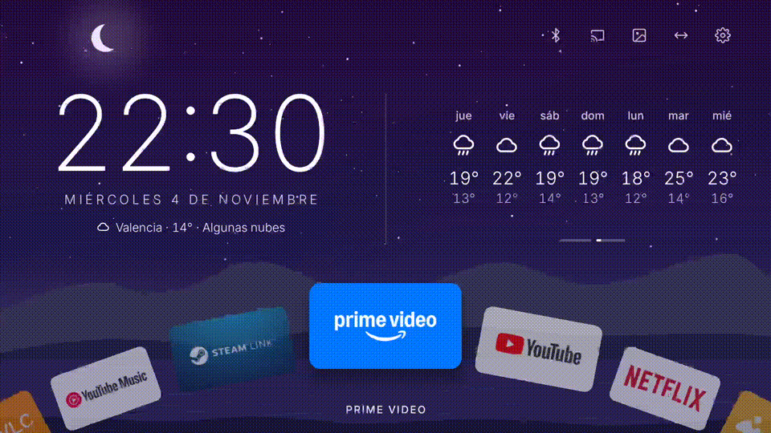
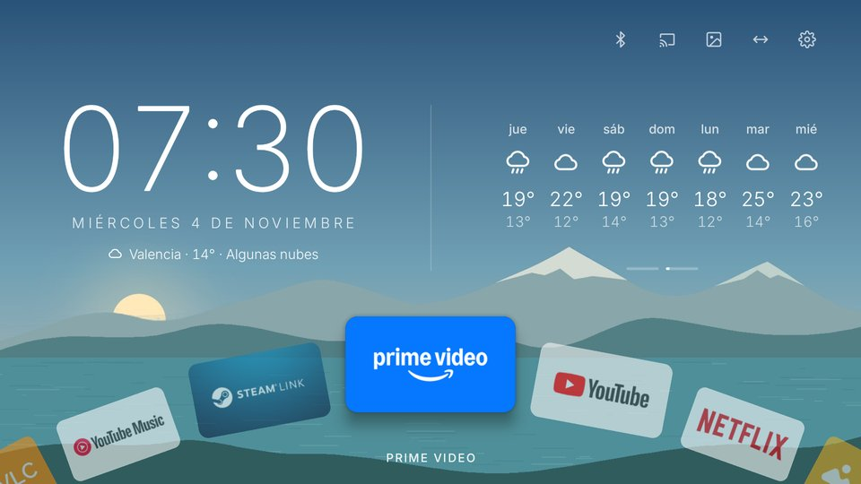
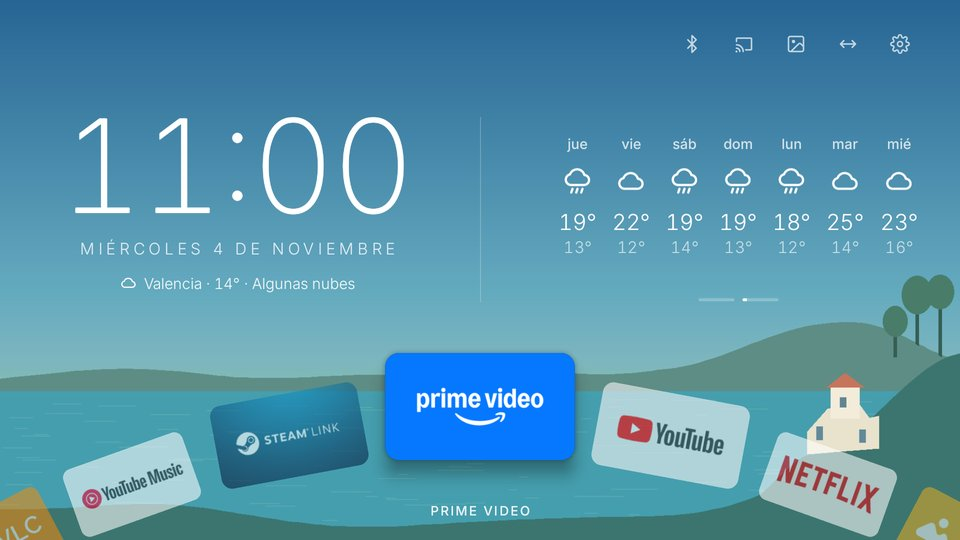
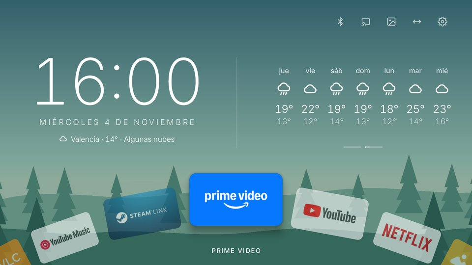
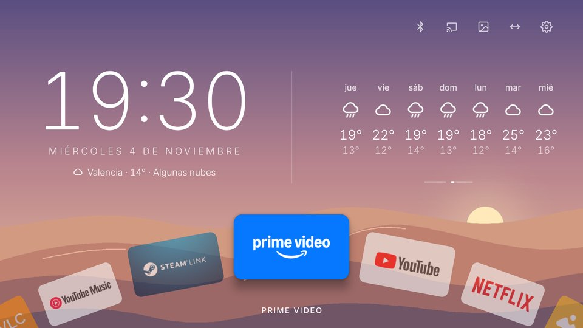
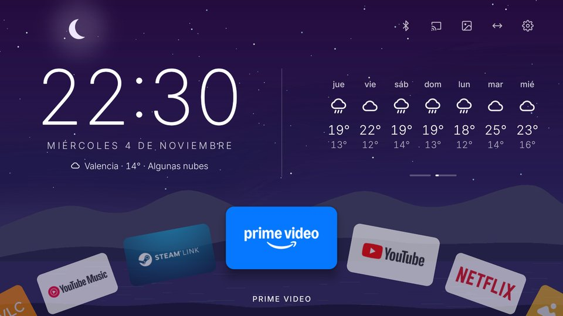

<div align="center">

# Spin Launcher TV

### Dale una vuelta a lo de siempre.

Un launcher para Android TV con una ruleta para decidir qué aplicación abrir.

**Mantén ◀ o ▶ durante 3 segundos. Deja que gire. Pulsa OK.**



*La ruleta elige una aplicación instalada; tú eliges qué ver dentro de ella.*

</div>

## La ruleta

¿Otra noche pasando de una aplicación a otra sin decidirte? Mantén pulsado izquierda o derecha en la rueda de aplicaciones: el launcher da paso a las luces, la rueda gira con un clic por cada app y se detiene en una, con confeti y petardos para celebrarlo. Los sonidos van por el canal de sonidos del sistema: siguen su volumen y callan si los desactivas.

La aplicación queda seleccionada. **No se abre sola**: pulsa OK para entrar o sigue navegando.

- Por defecto participan todas las apps. Puedes [excluir las que quieras](#excluir-apps-de-la-ruleta), por ejemplo herramientas que no son algo para ver.
- Con el permiso opcional de estadísticas de uso, las cinco aplicaciones elegibles más utilizadas en los últimos 30 días tienen el doble de probabilidades.
- Sin ese permiso, el sorteo reparte las mismas probabilidades entre las aplicaciones elegibles.

## También es tu pantalla de inicio

- **Rueda de aplicaciones:** navegación continua en ambos sentidos, con la app seleccionada destacada.
- **Reloj grande**, fecha y tiempo, con previsión de siete días de Open-Meteo.
- **Cinco paisajes Full HD**, que cambian según la hora local.
- **Ordenación manual** de las apps; las más utilizadas encabezan la rueda cuando se concede el permiso de uso.
- Accesos a **Bluetooth, duplicación de pantalla, salvapantallas y ajustes**.
- **Home Assistant opcional:** temperaturas de las habitaciones desde tus propios sensores.

| Hora local | Fondo | Cómo se ve |
| --- | --- | --- |
| 06:00–09:00 | Montañas |  |
| 09:00–14:00 | Mediterráneo |  |
| 14:00–18:00 | Bosque |  |
| 18:00–21:00 | Dunas |  |
| 21:00–06:00 | Aurora |  |

## Compatibilidad

**Probado en Xiaomi TV Box S de segunda generación, Android 11, con mando direccional y pantalla de inicio a 1920 × 1080.** El proyecto requiere Android 9 o posterior, pero los demás dispositivos no están verificados.

Limitaciones conocidas:

- **Bluetooth y duplicación de pantalla:** los dos accesos de la barra superior abren pantallas del firmware de la Xiaomi probada (`com.xiaomi.mitv.smartshare` para Miracast, y los ajustes de accesorios de Android TV para Bluetooth). En otros modelos pueden no hacer nada; puedes cambiar los componentes en `MainActivity.java` (`MIRACAST` y `ADD_ACCESSORY`).
- **Salvapantallas:** el botón usa `com.android.systemui/.Somnambulator`, que existe en Android TV estándar pero el fabricante puede retirarlo.
- **Botón Apps del mando:** se atiende con un servicio de accesibilidad que solo filtra esa tecla. Escucha `KEYCODE_ALL_APPS`; si el botón Apps de tu mando envía otra tecla, no hará nada.
- **Idioma:** la interfaz, la fecha y el nombre del tiempo están solo en español, y la localidad por defecto es Valencia.
- **Apps que no aparecen:** `HIDDEN` en `MainActivity.java` es la lista de apps instaladas que **no** reciben ficha en la rueda: la propia Spin, los ajustes de Android TV (ya tienen su botón con el engranaje), el receptor Miracast de Xiaomi (tiene su botón arriba) y el servicio de mando por móvil de Google. Siguen instaladas y activas; solo se omite su ficha. La última es preventiva: en la Xiaomi probada no aparece en la lista de apps.
- **Orden de las apps:** el código no trae ninguna lista de apps. Al instalar, la rueda va por orden alfabético; si concedes el permiso de uso, las más utilizadas pasan al principio. En cuanto ordenes a mano, se conserva tu orden y las apps nuevas se colocan detrás de las tuyas.
- **Primera app enfocada:** al instalar, la rueda empieza en la primera app. Después recuerda la última que abriste.

## Permisos

| Permiso | Para qué | Cómo se concede |
| --- | --- | --- |
| `INTERNET` | Previsión del tiempo (Open-Meteo) y, si lo configuras, Home Assistant | Automático |
| `BLUETOOTH` (solo hasta Android 11) | Saber si hay auriculares conectados | Automático |
| `PACKAGE_USAGE_STATS` | Ordenar por uso y dar doble probabilidad a las 5 apps más usadas | `adb shell appops set …` ([ver arriba](#4-permisos-opcionales)); es opcional |
| Servicio de accesibilidad | Atender el botón Apps del mando; solo filtra esa tecla | Manual, en los ajustes de accesibilidad; es opcional |
| Tráfico HTTP sin cifrar | Permitir un Home Assistant local sin HTTPS | Va en el manifiesto (`usesCleartextTraffic`). Si usas HTTPS no hace falta; con HTTP el token viaja sin cifrar por tu red |

## Valores que puedes ajustar

Van en un archivo `settings.json` que se escribe por ADB, sin volver a compilar. Todas las claves son opcionales: lo que falte o se salga de los límites usa el valor por defecto o el límite. Se lee cada vez que vuelves al inicio.

| Clave | Por defecto | Límites | Qué controla |
| --- | --- | --- | --- |
| `neverWins` | `[]` | — | Apps que la ruleta nunca elige ([ver abajo](#excluir-apps-de-la-ruleta)) |
| `neverTop` | `[]` | — | Apps que nunca entran entre las más usadas, así que nunca encabezan la rueda |
| `favourites` | 5 | 0–5 | Cuántas apps más usadas encabezan la rueda y tienen ventaja en la ruleta (0 lo quita) |
| `favouritesDays` | 30 | 1–365 | Días de uso que se miran |
| `favouriteTickets` | 2 | 1–10 | Papeletas de cada app más usada en la ruleta (1 = sin ventaja) |
| `holdSeconds` | 3 | 1–10 | Cuánto hay que mantener ◀ o ▶ para lanzar la ruleta |
| `cardSeconds` | 20 | 5–300 | Cada cuánto cambia el panel entre Casa y Semana |
| `refreshMinutes` | 10 | 1–120 | Cada cuánto se actualizan el tiempo y los sensores |

```bash
adb shell content write --uri content://com.enguicode.spinlaunchertv.config/settings.json < settings.json
```

## Compilar e instalar

¿Prefieres que lo haga una IA con acceso al shell? Hay un [prompt para instalarlo y, si quieres, limpiar la tele](PROMPT.md).

Este repositorio contiene el **código fuente**. Necesitas Git, Java 17, Android SDK 34 con Build Tools 34.0.0 y ADB. También puedes abrir el proyecto en Android Studio y usar su JDK 17.

### 1. Compilar

```bash
git clone https://github.com/enguicode/spin-launcher-tv.git
cd spin-launcher-tv
```

Configura la ruta de tu SDK en `local.properties` —Android Studio lo crea al abrir el proyecto—:

```properties
sdk.dir=/ruta/a/tu/android-sdk
```

```bash
./gradlew testReleaseUnitTest assembleRelease
```

En Windows puedes ejecutar la tarea desde Android Studio. La compilación se firma con la clave de desarrollo local que genera Android; conserva esa clave para poder actualizar tu instalación.

### 2. Conectar tu televisión

Activa las opciones de desarrollador y la depuración correspondiente a tu modelo. En la Xiaomi probada se utiliza «Depuración por USB» y ADB por red. Autoriza la conexión en la pantalla de la televisión.

```bash
adb connect IP_DE_TU_TV:5555
adb devices
```

Los siguientes comandos suponen que solo hay un dispositivo ADB conectado. Si hay varios, añade `-s IP_DE_TU_TV:5555` después de `adb`.

### 3. Guardar el launcher anterior e instalar

Antes del cambio, consulta y anota el componente de tu pantalla de inicio actual:

```bash
adb shell cmd package resolve-activity --brief -a android.intent.action.MAIN -c android.intent.category.HOME
adb install -r app/build/outputs/apk/release/app-release.apk
adb shell cmd package set-home-activity --user 0 com.enguicode.spinlaunchertv/.MainActivity
adb shell input keyevent KEYCODE_HOME
```

El identificador de la aplicación es `com.enguicode.spinlaunchertv`; el nombre visible es **Spin Launcher TV**.

### 4. Permisos opcionales

Para el botón Apps, activa **Botón Apps del mando** en los ajustes de accesibilidad del dispositivo. El servicio filtra esa tecla y no lee el contenido de las ventanas.

Para ordenar las apps por uso y darles el doble de probabilidades en la ruleta:

```bash
adb shell appops set com.enguicode.spinlaunchertv GET_USAGE_STATS allow
```

## Controles

| Mando | Acción |
| --- | --- |
| ◀ / ▶ | Girar la rueda y seleccionar una app |
| Mantener ◀ / ▶ durante 3 segundos | Lanzar la ruleta |
| OK | Abrir la app seleccionada |
| ▲ | Ir al panel de información o a la barra superior |
| ◀ / ▶ con el panel seleccionado | Cambiar entre temperaturas y previsión |
| ▼ | Volver a la rueda |
| Atrás | Salir de la ordenación o devolver el foco a la rueda |

Para ordenar, selecciona el icono de flechas de la barra superior, pulsa OK sobre una app, muévela con ◀ / ▶ y pulsa OK para dejarla. Termina con el icono de verificación. Las apps que encabezan la rueda por uso se muestran aparte durante la ordenación.

## Excluir apps de la ruleta

Por defecto, **todas las apps pueden salir elegidas**. Si hay alguna que no quieres que gane el sorteo (una tienda, un explorador de archivos, un reproductor…), pon su nombre de paquete en `neverWins` dentro de [`settings.json`](#valores-que-puedes-ajustar):

```json
{"neverWins": ["com.android.vending", "org.videolan.vlc", "com.mitv.gallery"]}
```

En el ejemplo: Play Store, VLC y la galería de Xiaomi.

Para saber el nombre de paquete de una app:

```bash
adb shell pm list packages | grep nombre
```

Cómo funciona la exclusión:

- Las apps excluidas **siguen girando en la rueda y se abren con normalidad**; solo se descartan como ganadoras.
- Si **todas** las apps instaladas están excluidas, el sorteo usa las que haya en lugar de fallar.
- El permiso de estadísticas de uso solo da ventaja a apps elegibles; una excluida nunca la recibe. Si está entre las más usadas, sale atenuada en «Top usadas».
- Para que tampoco encabece la rueda, ponla también en `neverTop`.
- Tras cambiar la lista, vuelve a escribir `settings.json`; no hace falta reinstalar.

## Tiempo y Home Assistant

El tiempo sale de Open-Meteo y muestra **Valencia por defecto**. Para cambiar la localidad y, si quieres, ver las temperaturas de casa desde Home Assistant, crea un `home.json` en tu ordenador. Todo es opcional salvo la localidad:

```json
{
  "place": "Madrid", "lat": 40.4168, "lon": -3.7038,
  "url": "https://TU_SERVIDOR_HOME_ASSISTANT",
  "token": "TU_TOKEN_DE_HOME_ASSISTANT",
  "sensors": [
    {"label": "Salón", "entity": "sensor.living_room_temperature", "icon": "sofa"},
    {"label": "Cocina", "entity": "sensor.kitchen_temperature", "icon": "pot"}
  ]
}
```

```bash
adb shell content write --uri content://com.enguicode.spinlaunchertv.config/home.json < home.json
```

- **Token:** uno de larga duración, creado en tu perfil de Home Assistant. Se guarda en los archivos privados de la app y no forma parte del código; no subas nunca tu `home.json` real a un repositorio. Mejor con HTTPS: con HTTP el token viaja sin cifrar por tu red.
- **Sensores:** de temperatura, con estado numérico; la app muestra grados y no convierte unidades. Iconos: `sofa`, `pot`, `desk`, `bed`, `star`, `bath`, `shower`, `balcony` y `washer`; uno desconocido muestra una casa. Una IA puede generarte la lista a partir de los nombres de tus entidades.
- **Cambiar solo las habitaciones:** escribe un `sensors.json` con `{"sensors": [...]}` por la misma vía (`…config/sensors.json`); sustituye a la lista de `home.json`, y `{"sensors": []}` las quita. Para quitar el token, vuelve a escribir `home.json` sin él.
- **Quién puede escribirlos:** la app solo acepta `home.json`, `sensors.json` y `settings.json`, solo para escribir y solo desde ADB o el sistema (permiso `WRITE_SECURE_SETTINGS`). Las demás apps no pueden leerlos.

La configuración se vuelve a leer al volver al inicio. Los datos se consultan directamente en tu servidor; el launcher no incluye analítica ni publicidad.

## Volver a la pantalla de inicio anterior

Restablece el componente que anotaste antes de instalar:

```bash
adb shell cmd package set-home-activity --user 0 PAQUETE_ANTERIOR/ACTIVIDAD_ANTERIOR
adb shell input keyevent KEYCODE_HOME
```

Después desactiva **Botón Apps del mando** en accesibilidad y, si quieres, desinstala Spin:

```bash
adb uninstall com.enguicode.spinlaunchertv
```

## ¿También limpia Google TV?

**Spin no desinstala ni desactiva nada por sí mismo**: solo sustituye la pantalla de inicio. La limpieza de la televisión es independiente y no es necesaria para probar la ruleta.

## Cómo se limpió la tele con cleanyourtv

El proyecto nació después de probar [cleanyourtv](https://github.com/Gathin23/cleanyourtv) (de Gathin, licencia MIT) en una Xiaomi TV Box S de segunda generación. Esto es lo que se utilizó de sus instrucciones, y lo que no:

- **Su `PROMPT.md`:** se siguió su método (conectar por ADB, comprobar cada paso con capturas de la propia tele y no tocar nada sin comprobarlo) con un asistente de IA con acceso al shell.
- **Su lista para la Mi Box S:** de [`examples/xiaomi-mi-box-s-2nd-gen/debloat.txt`](https://github.com/Gathin23/cleanyourtv/blob/main/examples/xiaomi-mi-box-s-2nd-gen/debloat.txt) se aplicó casi todo. Se dejó fuera Prime Video, que se quiso conservar, y se aplicaron al final `launcherx` y `setupwraith`, que esa lista indica desactivar solo cuando ya hay otro launcher como inicio.
- **Su forma de desactivar:** `pm disable-user --user 0 PAQUETE`, que es lo mismo que hace su script `tools/disable.sh`. No se usó el script, solo los comandos equivalentes. Nada se desinstala; se deshace con `pm enable`.
- **Sus notas sobre el mando:** de su documentación se aprovechó que el botón Apps llega como `KEYCODE_ALL_APPS` y que los botones Netflix, YouTube y Prime los atiende `partnercustomizer`, que por eso no se desactivó.

Spin **no** incluye código ni imágenes de cleanyourtv. La lista de paquetes es la de la Mi Box S y su firmware: en otro modelo usa su propio ejemplo de cleanyourtv, o no desactives nada. Estos son los **15 paquetes que se desactivaron** en la Xiaomi TV Box S de segunda generación:

| Paquete | Qué es |
| --- | --- |
| `com.miui.tv.analytics` | Analítica de Xiaomi |
| `com.google.android.feedback` | Envío de informes y comentarios a Google |
| `com.google.android.partnersetup` | Atribución de socios de Google |
| `com.mitv.tvhome.oemtab` | Fila de anuncios de Xiaomi |
| `com.mitv.tvhome.michannel` | Filas de contenido de Mi |
| `com.mitv.tvhome.mitvplus` | Canales con anuncios de Mi TV+ |
| `com.mitv.tvhome.atv` | PatchWall, el inicio de Xiaomi |
| `com.xm.webcontent` | Promociones web de Xiaomi |
| `android.autoinstalls.config.xioami.mibox3` | Instalación automática de apps de socios (el nombre lleva «xioami» así) |
| `com.xiaomi.mitv.updateservice` | Actualizaciones de firmware de Xiaomi; se puede reactivar para actualizar |
| `com.google.android.play.games` | Google Play Juegos |
| `com.android.printspooler` | Servicio de impresión |
| `com.google.android.videos` | Google TV / Play Películas |
| `com.google.android.apps.tv.launcherx` | La pantalla de inicio de Google TV, sustituida por Spin |
| `com.google.android.tungsten.setupwraith` | Asistente de configuración inicial |

Notas:

- **Orden:** no se puede desactivar el inicio de Google TV sin otro launcher puesto como inicio. Si no, Android entrega el inicio al asistente de configuración. Desactivar el asistente hizo que la tele pidiera de nuevo la clave del Wi-Fi.
- **Se dejó activo a propósito:** Prime Video, el Asistente de Google, el Chromecast integrado, el mando por móvil, el servicio que atiende los botones Netflix, YouTube y Prime del mando (`partnercustomizer`), el salvapantallas de Google Fotos y el receptor Miracast.
- **Cómo deshacerlo:** `adb shell pm enable PAQUETE`. Los que siguen desactivados se ven con `adb shell pm list packages -d`. Para que vuelva el inicio de Google TV, reactiva `launcherx` y `setupwraith` y vuelve a poner el launcher anterior como se explica [más arriba](#volver-a-la-pantalla-de-inicio-anterior).
- Esa lista es la de **la Mi Box S y esta versión de firmware**. En otro modelo usa su propio ejemplo de cleanyourtv, o no desactives nada.

## Licencia y créditos

Código y fondos: [MIT](LICENSE). La fuente Inter se distribuye bajo SIL OFL 1.1 y el wrapper de Gradle utiliza Apache 2.0. Consulta los [avisos de terceros](THIRD-PARTY-NOTICES.md).

Los banners e iconos de las aplicaciones se obtienen de las apps instaladas en el dispositivo. Sus marcas pertenecen a sus respectivos titulares; Spin no está afiliado a esas plataformas.
